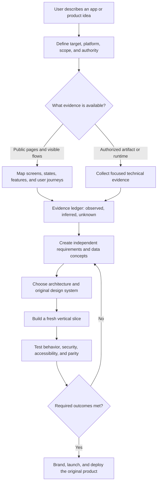

# REA Replica

[Português (Brasil)](README.pt-BR.md)

REA Replica is an original Codex orchestration skill created by Weslley Cardoso. Its approach is inspired by and follows the same general line as the established REA and Replica methodologies: evidence-backed understanding, explicit uncertainty, clean-room implementation, and staged product delivery. It does not contain or redistribute source code from those projects.

## What it does

- Routes public product research and user-visible behavior through `replica-recon`.
- Uses `reverse-engineer-anything` when a conclusion requires authorized binary, package, firmware, managed-code, JavaScript/Electron, runtime, or version-comparison evidence.
- Separates observations, inferences, and unknowns.
- Turns evidence into independent product requirements, interface contracts, and testable outcomes.
- Coordinates architecture, design, implementation, backend work, testing, branding, launch, and deployment through the installed `replica-*` skills.
- Prevents proprietary source, decompiled code, private APIs, credentials, assets, branding, and distinctive copy from entering the rebuilt product.

## How it works in practice



### Practical example: appointment-booking app

Request:

```text
Use $rea-replica to study the booking flow of an appointment app and design
an original version for independent beauty professionals.
```

REA Replica would:

1. Define the permitted sources and limit the scope to service selection, time-slot selection, customer details, confirmation, cancellation, and rescheduling.
2. Record the screens, empty/loading/error states, happy path, edge cases, and visible business rules.
3. Mark each conclusion as observed, inferred, or unknown.
4. Produce an independent feature matrix and data concepts such as Professional, Service, Availability, Customer, and Booking.
5. Design an original architecture, visual identity, API, and database rather than copying the target implementation.
6. Build the smallest working flow: choose service → choose time → enter details → confirm.
7. Test double booking, time zones, expired sessions, mobile layout, keyboard access, and user-data isolation.
8. Report what works, what remains unknown, and the next recommended stage.

Typical outputs:

```text
replica/recon.md
replica/features.csv
replica/architecture.md
replica/design-system.md
replica/test-plan.md
replica/bugs.md
```

## Language support

The skill responds in the user's language and explicitly supports English (US) and Portuguese (Brazil). Tool names, skill names, file paths, Evidence IDs, API identifiers, and code remain unchanged.

## Optional integrations

REA Replica can work with normal Codex tools on its own. When available, it can also work alongside:

- `reverse-engineer-anything` for specialized artifact evidence
- The `replica-*` skills for specialized product-delivery stages
- REA tools for authorized artifact analysis

These integrations are separate projects. This repository does not contain or redistribute their source code.

## Installation

Clone the repository into the Codex skills directory using the folder name `rea-replica`:

```bash
git clone https://github.com/wsavliscrds-art/Rea-replica.git ~/.codex/skills/rea-replica
```

On Windows PowerShell:

```powershell
git clone https://github.com/wsavliscrds-art/Rea-replica.git "$env:USERPROFILE\.codex\skills\rea-replica"
```

Start a new Codex message after installation.

## Usage

```text
Use $rea-replica to analyze this application and plan a clean-room reconstruction.
```

The skill can also be selected automatically when the request matches its description.

## Responsible use

Only analyze artifacts you own, are authorized to inspect, or may legitimately study for interoperability, compatibility, archival, or security-research purposes. Never bypass authentication, paywalls, licensing, or access controls.

The rebuilt product must use fresh implementation code and original branding and assets. REA evidence describes behavior and constraints; it is not source code for the replacement.

## License

MIT. See [LICENSE](LICENSE).
