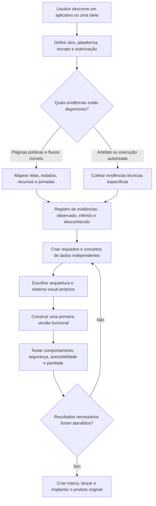

# REA Replica

[English (US)](README.md)

REA Replica é uma skill autoral de orquestração para o Codex, criada por Weslley Cardoso. Sua abordagem é inspirada e segue a mesma linha geral das metodologias estabelecidas por REA e Replica: compreensão baseada em evidências, incerteza explícita, implementação clean-room e entrega do produto em etapas. Ela não contém nem redistribui código-fonte desses projetos.

## O que ela faz

- Encaminha pesquisa pública do produto e comportamento visível ao usuário para `replica-recon`.
- Usa `reverse-engineer-anything` quando uma conclusão depende de evidências autorizadas de binários, pacotes, firmware, código gerenciado, JavaScript/Electron, execução ou comparação de versões.
- Separa observações, inferências e pontos desconhecidos.
- Transforma evidências em requisitos independentes, contratos de interface e resultados testáveis.
- Coordena arquitetura, design, implementação, backend, testes, marca, lançamento e implantação por meio das skills `replica-*` instaladas.
- Impede que código-fonte proprietário, código decompilado, APIs privadas, credenciais, recursos visuais, marcas ou textos distintivos entrem no produto reconstruído.

## Como funciona na prática



### Exemplo prático: aplicativo de agendamentos

Pedido:

```text
Use $rea-replica para estudar o fluxo de agendamento de um aplicativo e
projetar uma versão original para profissionais de beleza independentes.
```

A REA Replica:

1. Define as fontes permitidas e limita o escopo à escolha do serviço, escolha do horário, dados do cliente, confirmação, cancelamento e reagendamento.
2. Registra telas, estados vazios/carregando/erro, caminho principal, casos extremos e regras de negócio visíveis.
3. Marca cada conclusão como observada, inferida ou desconhecida.
4. Produz uma matriz independente de funcionalidades e conceitos como Profissional, Serviço, Disponibilidade, Cliente e Agendamento.
5. Projeta arquitetura, identidade visual, API e banco de dados próprios, sem copiar a implementação analisada.
6. Constrói o menor fluxo funcional: escolher serviço → escolher horário → informar dados → confirmar.
7. Testa reserva duplicada, fusos horários, sessão expirada, versão móvel, uso por teclado e isolamento dos dados dos usuários.
8. Informa o que funciona, o que permanece desconhecido e qual é a próxima etapa recomendada.

Saídas típicas:

```text
replica/recon.md
replica/features.csv
replica/architecture.md
replica/design-system.md
replica/test-plan.md
replica/bugs.md
```

## Idiomas

A skill responde no idioma do usuário e oferece suporte explícito a inglês dos Estados Unidos e português do Brasil. Nomes de ferramentas, nomes de skills, caminhos, Evidence IDs, identificadores de APIs e código permanecem inalterados.

## Integrações opcionais

REA Replica pode trabalhar de forma independente com as ferramentas normais do Codex. Quando disponíveis, também pode trabalhar em conjunto com:

- `reverse-engineer-anything` para evidências técnicas especializadas
- As skills `replica-*` para etapas especializadas de entrega do produto
- As ferramentas REA para análise autorizada de artefatos

Essas integrações são projetos separados. Este repositório não contém nem redistribui o código-fonte deles.

## Instalação

Clone o repositório no diretório de skills do Codex usando o nome de pasta `rea-replica`:

```bash
git clone https://github.com/wsavliscrds-art/Rea-replica.git ~/.codex/skills/rea-replica
```

No Windows PowerShell:

```powershell
git clone https://github.com/wsavliscrds-art/Rea-replica.git "$env:USERPROFILE\.codex\skills\rea-replica"
```

Inicie uma nova mensagem no Codex após a instalação.

## Uso

```text
Use $rea-replica para analisar este aplicativo e planejar uma reconstrução clean-room.
```

A skill também pode ser selecionada automaticamente quando o pedido corresponder à sua descrição.

## Uso responsável

Analise somente artefatos que você possui, tem autorização para inspecionar ou pode estudar legitimamente para interoperabilidade, compatibilidade, preservação ou pesquisa de segurança. Nunca contorne autenticação, paywalls, licenciamento ou controles de acesso.

O produto reconstruído deve usar código novo, marca própria e recursos originais. As evidências da REA descrevem comportamento e restrições; elas não são código-fonte para o substituto.

## Licença

MIT. Consulte [LICENSE](LICENSE).
